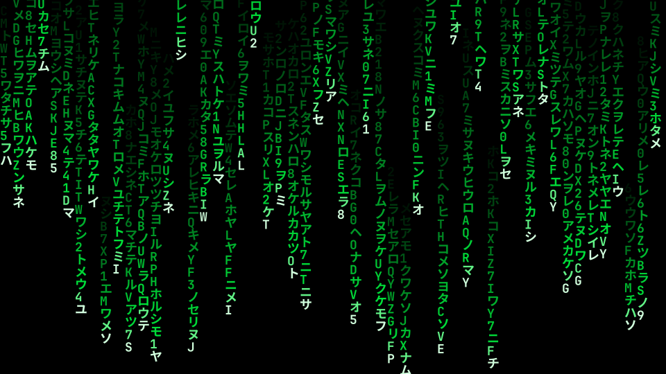
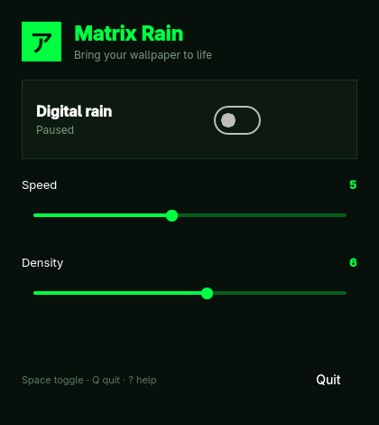

# Matrix Rain



A small Omarchy app that brings your wallpaper to life: green code rains down
the screen behind your windows, and a single switch turns it on or off.



## What it does

Matrix Rain puts a transparent, full-screen surface on Hyprland's **bottom**
layer. It sits above the wallpaper and below your apps, so the code falls
behind your work instead of covering it. The surface has no keyboard
interactivity, so it never steals focus or clicks.

Each column carries its own speed, trail length and stream of katakana,
digits and letters. The leading glyph is bright, the tail fades, and a few
characters shimmer each tick. The accent follows the current Omarchy theme
live — change the theme and the rain changes with it.

## Controls

| Key | Action |
| --- | --- |
| `Space` | Toggle the rain on or off |
| `Q` | Quit |
| `?` | Show or hide the shortcut overlay |

The switch in the window does the same thing as `Space`. Speed and density
are adjustable, and all three settings are remembered between launches.
Editing `~/.config/matrixrain/matrixrain.conf` while the app is running takes
effect immediately. Closing the control window quits the app and removes the
overlay; while the effect is off the renderer's timer stops and it costs no
CPU.

## Development

```sh
bin/build      # qmake6 + make into build/matrixrain
bin/test       # Qt Test suite, offscreen
bin/install    # build and install as an Arch package
```

C++ owns the state, settings, theme following, layer-shell surface and the
rain renderer (a cached glyph atlas blitted through `QQuickPaintedItem`); QML
owns the two windows and their layout. Everything is compiled into one binary
by `qmake6`.

## Attribution

Theme and translator patterns follow Omacut and Monologue (MIT, David
Heinemeier Hansson). Licensed under MIT; see `LICENSE`.
